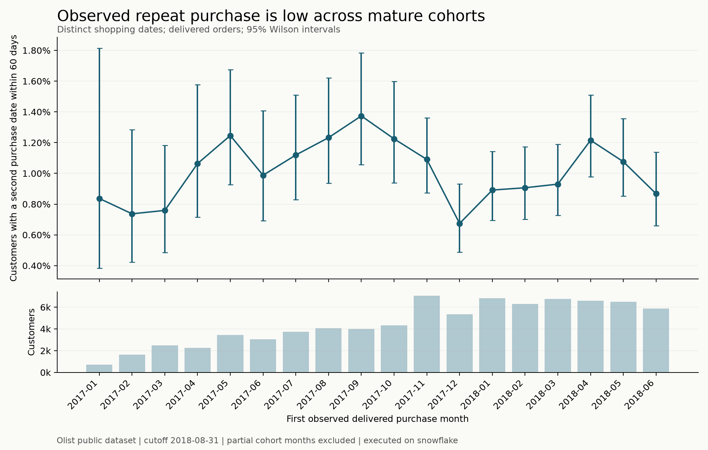

# Commercial recommendation: validate second-purchase growth before subsidising it

**Client lens:** a hypothetical Olist-like marketplace operator. This is a historical decision exercise using anonymised 2016-2018 transactions, not a claim about Olist's current business or Elio's actual clients.

**Execution status:** the numbers below were reproduced from the dbt marts on **Snowflake**. The cloud build passed all 17 models, 89 data tests and 5 unit tests. All nine analytical query outputs match the independent local validation target. Engine-specific outputs and Snowflake query IDs are in `analysis/results/`; [verification evidence](docs/verification.md) records the executed checks.

## B1. Commercial insight

**Finding.** Repeat purchasing is uncommon within the observable window, so a broad coupon campaign has weak support. Among **81,344** customers with a complete 60-day observation window, **832** made a second purchase on a later shopping date: **1.02%** (95% Wilson interval **0.96%-1.09%**). This does not mean the other 98.98% churned: purchases outside these marketplaces, outside the extract, or under another identity are unobserved.

**Method.** Identify buyers using `customer_unique_id`, aggregate delivered orders on the same calendar day into a shopping occasion, and compare the first and second distinct shopping dates. First observed purchases run from 2017-01-01 through 2018-07-02, allowing 60 full days before the fixed 2018-08-31 cutoff. The monthly chart excludes July's partially mature cohort. Final snapshot status determines eventual delivered purchases; this is descriptive analysis, not a historical causal backtest.

**Why it matters.** Sending incentives to everyone would pay for some purchases that would happen anyway. The more actionable historical segment is customers who were still waiting for a second shopping occasion 30 days after an on-time first delivery. Among **73,082** such customers with another 30 days of observation, **244** repurchased: **0.334%** (95% interval **0.295%-0.378%**). Their **251** subsequent orders averaged **R$119.41** in merchandise value, excluding freight. These small event counts favour a simple controlled test over elaborate churn prediction or a precise lifetime-value claim.

**Category differences are exploratory.** For example, mixed-category first occasions show 24/888 repeat buyers (2.70%), but basket size, selection and multiple comparisons may explain the difference. I would not target or promise uplift solely from that ranking. The SQL includes denominators and a minimum display sample of 500 customers.

## B2. One concrete action: a capped, no-discount second-purchase reminder test

### Target and mechanic

Use the existing CRM to send one reminder featuring the customer's original category, or a generic marketplace link for mixed/unknown categories. No coupon is offered in this first experiment.

Eligible customers must have exactly one observed delivered shopping occasion; its orders arrived on time with known delivery timestamps; delivery was 30-60 days ago; and no subsequent order, including an in-flight order, is present. Recheck eligibility immediately before sending. Production also requires a usable contact, marketing consent, no unresolved complaint/refund, and no overlapping retention campaign; those fields are absent from this dataset and are not assumed to be available.

`mart_activation_candidates` returns **5,718** illustrative customers at 2018-08-31. This is an audience definition, not an executable contact list. The day-30 historical baseline is only a planning proxy for a 30-60-day backlog: survivors at day 60 may behave differently. Stratify the test by days since delivery (30-44 versus 45-60), and use the concurrent control rather than the historical rate to measure lift.

### Commercial impact and a spending gate

The data supplies candidate count and a historical order-value benchmark. The following inputs are **assumptions**, not estimated treatment effects or known platform economics:

- 50% of candidates can legitimately be reached: **2,859** customers.
- An incremental converting buyer contributes one additional order worth **R$119.41**; natural repeat buyers may not represent incremental buyers.
- The platform retains **10% of merchandise GMV as contribution after non-marketing variable costs**. This is not a reported Olist take rate; finance must replace it with actual unit economics.
- Delivery of the message costs **R$0.02** per treated customer; fixed CRM/setup/creative costs are excluded below and must be added before launch.

Illustrative **full-rollout** scenarios for those 2,859 reachable customers, separate from the 50/50 experiment:

| Absolute increase in 30-day purchase probability | Extra orders | Extra merchandise GMV | Incremental contribution after message cost, before fixed costs |
|---|---:|---:|---:|
| 0 percentage points | 0.0 | R$0 | **-R$57** |
| 0.25 percentage points | 7.1 | R$853 | **R$28** |
| 0.50 percentage points | 14.3 | R$1,707 | **R$114** |
| 1.00 percentage point | 28.6 | R$3,414 | **R$284** |

Formula: `reachable customers × absolute lift × order value × contribution rate − all message costs − fixed costs`. Without fixed costs, break-even lift is approximately **0.167 percentage points** at the assumed margin. A 0.50-point lift would move purchase probability from about 0.334% to 0.834%, roughly 2.5 times baseline: even that scenario is ambitious, not a forecast.

For comparison, if every converting treated customer redeemed a **R$10** coupon, the 0.50-point scenario would lose approximately **R$125 before fixed costs**, because subsidies are paid to natural purchasers as well as incremental purchasers. The coupon comparison assumes full redemption and no extra basket-value effect; it is a sensitivity illustration, not a prediction of coupon behaviour.

**Decision:** permit the no-discount pilot only using an existing low-cost CRM workflow and a separately approved learning budget. This extract does not justify bespoke campaign engineering or a large paid promotion. If setup cost alone exceeds roughly R$114, the 0.50-point one-batch rollout scenario does not recover it; a client must justify larger reachable volume, higher contribution, or learning value before proceeding. This spending gate is part of the recommendation, not an omitted cost.

### Measurement and timing

Randomise eligible customers 50/50, persist assignment at stable customer identity, and suppress crossover or duplicate sends. The control receives no extra retention reminder; ordinary transactional messages continue in both arms. Primary outcome is a delivered second purchase placed within 30 days of assignment; analyse all assigned customers by intention to treat and allow orders to settle before final reporting. Report absolute lift and confidence intervals, incremental contribution per assigned customer using actual finance inputs, and unsubscribe/complaint/refund guardrails. Opens and coupon redemption are not success metrics.

A normal-approximation design using the historical 0.334% rate needs about **3,644 customers per arm** to detect a **0.50 percentage-point** absolute increase with 80% power and a two-sided 5% test. The one-time 2,859 reachable-customer scenario is **underpowered** for that target. Validate baseline and reach first; enrol a rolling audience for up to **12 weeks**, aiming for at least **7,288 reachable eligible customers**, then allow 30 days of follow-up and a predefined delivery-settlement window. Week 6 is an operational check, not a significance-based stopping rule; report the main result around **week 16 plus settlement time**. If enrolment is insufficient, report the trial as inconclusive rather than presenting an absence of significance as proof of no effect. Confirm sample size with an exact/rare-event calculation before launching; the calculation here is for sizing the proposal.

## B3. Assumptions, caveats and data quality

The currency is treated as BRL for this Brazilian dataset. Merchandise GMV, payment amount and freight are separate measures; neither commission, refunds, cost of goods nor profit is observed. Returns after a final delivered status may be absent. The source does not establish a timezone, so its timestamps are preserved without asserting UTC. First observed purchase is left-censored, recent cohorts are right-censored, and final snapshot statuses prevent a perfect point-in-time reconstruction. The tiny September/October 2018 tail is retained for traceability but excluded from behavioural conclusions.

Observed source issues are retained visibly: **8** delivered orders have no delivery timestamp; **1** delivered order has no payment record; **299** delivered orders differ by more than R$0.01 between recorded payment and item-plus-freight totals. Across all statuses there are **303** such discrepancies. **610** products lack a category, **2** named categories lack an English translation, and **9** payment records have a zero value. A translation-file UTF-8 BOM is handled at parsing. No malformed CSV record or conflicting business-key payload was found in the six loaded files. These statements are reproduced by the load manifest, source tests and quality queries; none is repaired by inventing values.

Top three production checks:

1. **Identity and relationship integrity:** non-null/unique customer, order and compound item/payment keys; no conflicting same-key payloads; no orphan joins. Fail publication if these break.
2. **Grain and financial conservation:** reconcile source-to-mart order/item counts and additive amounts. Retain and monitor payment discrepancies separately; missing payment is not zero. Alert on a change in the exception rate rather than forcing historical differences to disappear.
3. **Batch completeness and temporal validity:** validate schema, UTF-8, expected file/row counts, parse failures and order/delivery chronology. On a live feed, alert on missing scheduled batches and source update delay. For this static archive, comparing its 2018 purchase dates with today's date would be an invalid freshness alarm; `_loaded_at` measures arrival, not source recency.

## B4. Client memo (under 200 words)

> To: CFO / COO  
> Subject: Test repeat-purchase growth before funding discounts
>
> The project organises six raw commerce files into traceable Snowflake loading and tested dbt customer, product and order tables. Snowflake and local validation runs both pass, with matching analytical outputs.
>
> Only 1.02% of customers with a complete 60-day observation window made a second purchase on a later shopping date. This measures observed marketplace activity, not total customer loyalty. Missing payment and delivery records remain visible rather than being disguised as zero.
>
> I recommend a controlled, no-discount reminder test using the existing CRM, after confirming contactability, consent and actual contribution margins. The historical audience contains 5,718 candidates. Assuming half are reachable, a 0.50 percentage-point lift would add roughly R$1,707 in merchandise value but only R$114 in contribution after message costs and before setup costs. That is a scenario, not a forecast.
>
> This supports a tightly capped learning exercise, not bespoke campaign development. Use a concurrent holdout, accumulate sufficient eligible customers, and scale only if measured incremental contribution covers all costs. Broad coupons are not justified by the available evidence.

## B5. Optional LLM use case

Use a governed question-answering layer over the documented marts. Example: **"How many eligible customers can we target, and what assumptions would make a reminder profitable?"** Retrieve only the approved audience aggregate, historical baseline, finance-provided unit economics and their definitions; return a short summary with executed-query references and an explicit assumptions table. The main risk is inventing revenue or treating scenarios as proven uplift. Mitigate it with allowlisted read-only queries, semantic definitions distinguishing GMV from contribution, required source links, and human review before any business action; an LLM must not send campaigns or alter audiences on its own.

## Reproduction and sources

- `sql/analytics_queries.sql`: named queries against marts; the top-products, monthly-cohort and category queries satisfy A5 categories 1, 2 and 4.
- `scripts/run_analysis.py`: produces engine-labelled JSON/CSV results and, on Snowflake, query IDs.
- `scripts/summarise_results.py`: reproduces Wilson intervals, scenario arithmetic, approximate sample size and the cohort chart.
- [Olist publisher data card](https://www.kaggle.com/datasets/olistbr/brazilian-ecommerce): dataset scope and customer identity semantics.
- [Elio](https://www.elio.agency/): data foundations connected to measurable acquisition, conversion, retention and efficiency.
