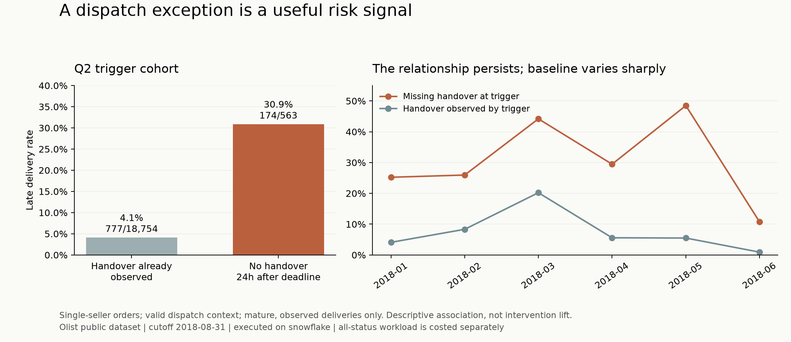

# Commercial decision: test dispatch recovery before buying another purchase

**Recommendation:** prioritise a small, gated dispatch-exception pilot using existing operations tools. Keep the no-discount repurchase reminder as the fallback; do not launch a broad coupon or category acquisition campaign from this extract.

**Client lens:** a hypothetical marketplace operator using Olist's anonymised historical transactions, not Olist's current business. Elio combines data engineering with commercial decisions; its [eZone case study](https://elio.agency/work/ezone) illustrates comparing lifecycle opportunities and investigating operational costs. That informs the questions here; eZone's reported results are not evidence of an achievable Olist uplift.

The pipeline has been executed on **Snowflake**: **20 models, 110 data tests and 7 unit tests** pass. Aggregate SQL results and query IDs are in [the Snowflake outputs](analysis/results/snowflake/); [verification](docs/verification.md) distinguishes executed work from the proposed intervention.

## Opportunity choice

The comparison uses **2018 Q2 eligibility flows**, not a quarterly logistics population against a one-day CRM backlog. Rankings are judgement about which decision to investigate first, not estimated causal returns.

| Opportunity | What the data establishes | Decision |
|---|---|---|
| **Dispatch-exception recovery** | 679 reconstructed alerts; 563 mature, assessable deliveries; 174 were late. A named operations owner can act before the promise date. | **First, conditional on live event quality and finance validation.** Strong observable risk signal; modest, assumption-sensitive economics. |
| **Second-purchase reminder** | 18,058 day-30 eligible customers in Q2; 63 naturally repeated in the next 30 days (0.349%). At assumed 50% reach, +0.5 percentage points and 10% contribution, quarterly contribution is R$443 before setup. | **Fallback in an existing CRM.** Positive lift is unproven; consent, reach and contribution are missing. No coupon. |
| **Category-led merchandising/acquisition** | Watches/gifts and health/beauty each generate about 10.4% of Q2 delivered merchandise GMV. | **Defer spend.** Transaction share does not reveal traffic, conversion, incremental demand, category margin or CAC. Request those inputs first. |

[Detailed comparison, decision reversals and reproducible economics](docs/opportunity_assessment.md). The recommendation can change: at only **R$10** avoidable cost per prevented late delivery, even the 10-point dispatch scenario loses **R$277** after setup. Neither opportunity justifies bespoke engineering at this observed scale.

## B1. Two findings and why they matter

**1. Missing handover after the shipping deadline identifies operational risk while time remains to act.** Reconstruct a trigger 24 hours after the earliest item shipping deadline. Require one seller, complete item deadlines/seller IDs, approval by the trigger, valid chronology and at least two calendar days before promised delivery. Across Q2 trigger dates, **174/563** mature, observed deliveries were late (**30.9%; 95% Wilson interval 27.2%-34.8%**), versus **777/18,754 (4.1%)** with a handover already observed. Median remaining promise lead in the alert group was **17 days**.

The gap persists in each January-June month. Reweighting the comparator to the alert group's destination-state mix gives **4.4%**, so destination mix alone does not explain it. Neither adjustment establishes causality: seller capability, product mix, calendar disruptions and selection can still explain the association. The **26.8-point gap is not a recoverable treatment effect**, and a missing scan does not prove seller fault.

**2. Delivery failure coincides with a worse customer experience, but reviews are not financial losses.** In a separate mature Q2 **purchase** cohort, **432/801 (53.9%)** reviewed late deliveries had a 1-2-star first response, versus **1,665/18,525 (9.0%)** on-time deliveries. The latest-response sensitivity gives the same counts. **505** late-order responses preceded actual delivery: this measures experience during the journey, not exclusively post-delivery satisfaction. Respondents can differ from nonrespondents; causality and subsequent customer value are unproven.

The review source has **99,224** review/order pairs, but `review_id` alone is not unique. The pipeline preserves the compound key and selects one first response per order through the cutoff, with latest response retained only for sensitivity. This prevents reviews from multiplying order amounts. Free text stays outside analytical marts.

## B2. One action: a seller-owned dispatch exception pilot

### Target, owner and workflow

**Owner: Marketplace Operations**, with finance supplying avoidable costs and data engineering supplying event checks.

At the trigger described above, confirm the order is currently approved/invoiced/processing, unpaid/canceled/unavailable states are suppressed, and no handover or delivery has actually occurred. Send the seller one existing-channel task to confirm pickup or explain the missing scan. Escalate unresolved cases to the existing operations queue after 24 hours. Do not automatically refund, discount or pay for expedited delivery. An operator checks inventory and carrier status before deciding what to do.

The 24-hour grace period is an operational hypothesis, not an optimised threshold. Log seller response, actual pickup and action cost. Persist one task per order/trigger/rule version, assign the seller consistently to a trial arm, and recheck state immediately before any action. Changes to shipping promises must not reset the original deadline silently.

The implementation supplies the order-grain [`mart_delivery_risk`](dbt_project/models/marts/mart_delivery_risk.sql) and a [current-snapshot worklist reference](sql/dispatch_worklist.sql). The latter excludes canceled/completed orders and stale backlog; it is not a deployed notification integration. The historical flag cannot recover cancellation time, event-arrival time or deadline revisions. **679 is a workload proxy, not 679 verified actionable orders.** Of these, **116** lack an assessable delivered outcome; all 679 are nevertheless charged handling cost below.

### Economics: avoided cost, not recovered GMV

Quarterly full-rollout scenarios use three **unverified planning assumptions**: R$30 genuinely avoidable support/credit/carrier cost per prevented late delivery, R$0.50 blended cost per proxy alert, and R$500 one-time setup. Finance must replace them. R$0.50 must include message/API charges and weighted manual handling; it is not a credible allowance for extensive human investigation of every case. Setup must include engineering and operations time.

`Net value = 563 assessable deliveries × absolute late-rate reduction × avoidable cost − 679 alerts × handling cost − setup`.

| Absolute late-rate reduction | Prevented late deliveries | Net before setup | Net after R$500 setup |
|---|---:|---:|---:|
| 0 points | 0.0 | -R$340 | **-R$840** |
| 5 points | 28.2 | R$505 | **R$5** |
| 10 points | 56.3 | R$1,350 | **R$850** |

These are sensitivities, not forecasts. A 10-point reduction from 30.9% is a substantial **32% relative improvement**. The 5-point case barely breaks even, so the pilot has **no comfortable financial cushion**. At 10 points, avoidable cost must exceed **R$14.91** per prevented late delivery; at 5 points it must exceed **R$29.82**. The observed **R$103,412** GMV of assessable alerts is exposure only and is **not counted as saved revenue**. Do not add speculative LTV or monetise star ratings.

**Spending gate:** first validate current alert quality and unit costs within an existing operations workflow. The R$500 setup ceiling is a proposed learning budget, not an approved spend or demonstrated implementation cost. If the required integrations exceed it, or finance cannot substantiate avoidable costs, do not launch this pilot. Reassess the CRM fallback with its actual reach, margin and setup cost instead.

### Measurement within 16 weeks, with an explicit power limit

**Weeks 1-2:** shadow the rule without seller contact. Check original deadlines, source-event freshness, cancellation suppression, real eligible volume, seller cluster sizes, handling time and finance costs. Freeze definitions and go/no-go criteria before randomisation.

**Weeks 3-12:** randomise **sellers**, not individual orders, 50/50 to intervention versus business as usual, balancing prior eligible volume and lateness. Persist assignment to limit seller-level spillover. Analyse all eligible assigned orders by intention to treat; never remove an order because it was later canceled. Existing support continues in both arms.

**Primary pilot endpoint:** carrier-confirmed handover within 48 hours of assignment, reported at week 13 with cluster-aware uncertainty. The all-status historical proxy is **252/679 (37.1%)**. Detecting a **15-point absolute improvement** needs approximately **172 independent orders per arm**, or **430 total** after an assumed 1.25 cluster design effect (80% power, two-sided 5%). Q2 flow implies about **522 proxy alerts over ten weeks**, before live eligibility exclusions. The design effect and eligibility rate must be re-estimated during shadowing; insufficient volume means an inconclusive pilot or a pre-agreed longer study.

**Week 16:** report on-time fulfilled orders per assigned order, cancellations/refunds, low ratings, seller burden and realised variable cost per assigned order. Cancellations and orders still undelivered at promise +30 days do not count as successful fulfilment; missing event feeds are reported separately, not silently labelled on time. Allow 30 days after the promised date for delivery outcomes and extend follow-up for later promises. A scan alone is insufficient: audit pickup evidence and downstream delivery to detect premature scans. The delivered-only historical baseline suggests roughly **753 assessable orders** to detect a 10-point late-delivery improvement under the same assumed clustering, more than this pilot is likely to provide. This is a sizing warning, not the final power calculation for the all-assigned fulfilment endpoint; re-estimate that baseline during shadowing. **Do not claim that the week-13 process result proves profitable delivery improvement.** Scale only after measured cost benefit and downstream guardrails support it; otherwise extend or stop.

## B3. Limitations and the three production checks that matter most

The fixed cutoff is 2018-08-31; delivery cohorts require promised date +30 days by cutoff and actual delivery observed by cutoff. Conditioning on delivered orders can exclude the worst failures, which is why all-status workload and unknown outcomes are separate. The static extract cannot establish what data was available at each historical trigger. Timestamps have no established timezone. BRL is assumed; GMV, freight charged, payments and profit are different quantities. Refunds, compensation, carrier cost, support tickets, consent and contactability are absent. These limits prevent a confident ROI forecast.

The original repeat analysis remains available: **832/81,344 (1.02%)** mature buyers returned on a later shopping date within 60 days. Low observed repeat purchasing alone is not proof of churn or the highest-value intervention.

Top three production controls:

1. **Operational time and state:** monitor event arrival lag, invalid chronology, original versus revised deadlines and missing seller/parcel links; suppress stale, canceled and already-dispatched tasks and alert the operations owner on feed failures.
2. **Grain and completeness:** enforce order/item/payment/review compound keys, relationships, conflicting-payload failures and order/GMV conservation. Never multiply facts through multi-review or multi-payment joins; quarantine unreliable dispatch context.
3. **Outcome and money reconciliation:** retain unmatched payments, missing deliveries, cancellations and unreviewed orders; reconcile credits/refunds/support/carrier costs with finance. Track observation-window maturity and denominator losses by trial arm.

Observed exceptions remain visible: 8 delivered orders lack delivery timestamps, 1 lacks a payment record, and 299 have payment discrepancies above R$0.01; 610 products lack categories and 2 named categories lack English translation. Passing tests validate stated contracts, not complete business truth. [Quality evidence](docs/verification.md).

## B4. Client memo (under 200 words)

**To: COO and CFO**

**Subject: Validate dispatch recovery before funding another-purchase incentives**

I recommend a tightly capped dispatch-exception pilot using existing operations tools.

In the historical Q2 trigger cohort, 174 of 563 assessable deliveries with no handover 24 hours after their shipping deadline arrived late: 30.9%, versus 4.1% where handover was already observed. This identifies risk; it does not establish the effect of intervening. There were 679 proxy alerts across all statuses, including 116 without an assessable delivered outcome.

Operations would confirm pickup with the seller, then escalate unresolved cases. Finance must first validate avoidable support, credit and carrier costs. Assuming R$30 per prevented late delivery, R$0.50 per alert and R$500 setup, a ten-point reduction yields about R$850 quarterly net value; five points barely breaks even. These are scenarios, not promised savings.

Use two weeks of shadowing and ten weeks of seller-randomised testing. Read out 48-hour handover at week 13, then matured delivery, cancellations and cost outcomes around week 16. Faster scans alone are insufficient to scale.

Retain a no-discount CRM reminder as the fallback. Defer category acquisition spend until exposure, margin and acquisition-cost data exist. Stop if eligibility, costs or sample size invalidate the pilot.

## B5. Optional governed LLM use

Use an LLM to draft an internal operations summary from approved aggregate metrics, not to predict fault or contact sellers autonomously. Retrieve the semantic definitions, alert counts by state, response coverage, actual finance-approved cost inputs and source query IDs. Do not supply review comments, contact details or individual orders.

**Example prompt:** “Using only these validated aggregates and metric definitions, summarise the dispatch-risk trend for the COO. Separate observations, assumptions and missing inputs; cite query IDs. Explain that review timing may precede delivery and that a risk association is not intervention lift. If a financial input is missing, state that net benefit is unknown. Return observation, uncertainty and next decision.”

**Expected output:** a cited, short briefing with denominators and explicit unknowns, reviewed by the operations owner. Enforce read-only allowlisted queries, prohibit invented costs or causal claims, treat any retrieved text as untrusted, log source versions, and check numbers deterministically. No agent or production integration is implemented.
