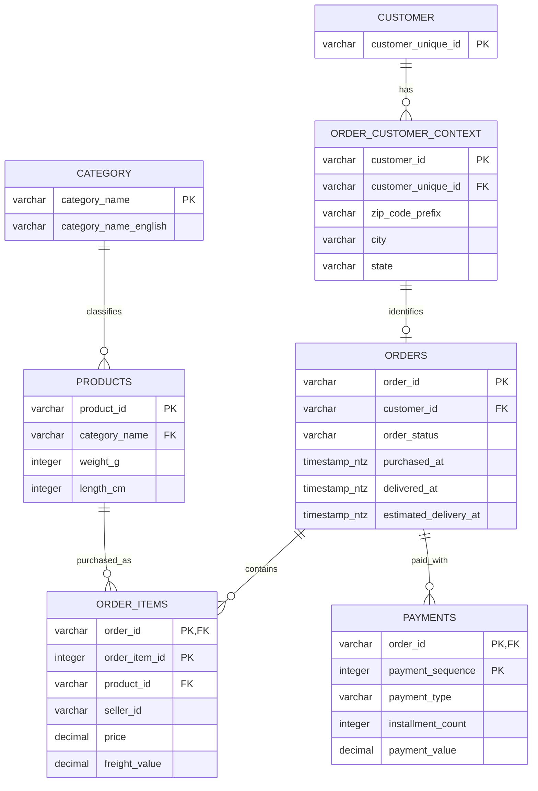
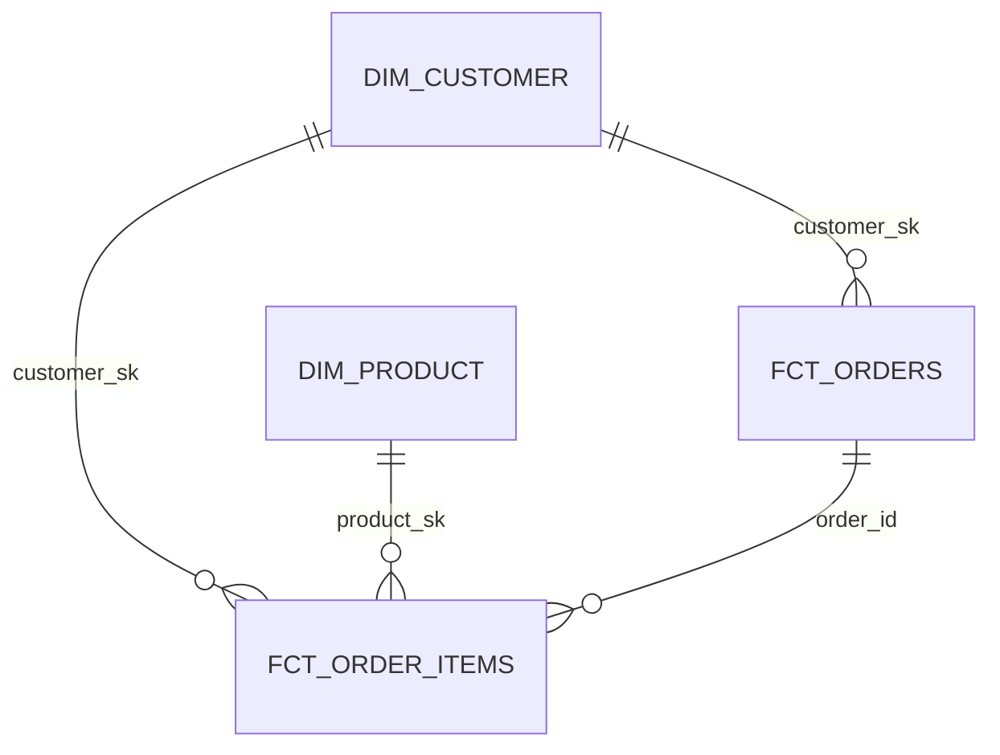

# Domain model and analytical design

## Scope and grain

Six publisher files are used: customers, orders, order items, products, payments and category translation. Reviews, sellers and geolocation are not required for this question. Seller IDs are retained on item facts without inventing unavailable seller attributes. No ZIP-to-city dependency is assumed: a postal prefix is not a unique location identifier.

The CUSTOMER entity is implemented by `int_customers`; ORDER_CUSTOMER_CONTEXT by `int_order_customers`; CATEGORY by `int_categories`; the remaining conformed entities are `stg_orders`, `stg_order_items`, `stg_products` and `stg_payments`. The nullable product category maps to the explicit `__unknown__` category at the conformed-to-mart boundary. Publisher category translations without products need not create unused dimension members.

## Normalisation reasoning (five sentences)

Stable customer identity is separated from the order-specific customer/address context so moving house does not rewrite earlier order geography. Order-item records resolve the many-to-many relationship between orders and products, with `(order_id, order_item_id)` identifying an item rather than an assumed quantity. Payments remain a separate child entity keyed by `(order_id, payment_sequence)`, so multiple tender records cannot multiply product amounts. Product properties depend on the product key while translated labels depend on the category key, keeping those attributes separate in the conformed layer. The marts deliberately flatten category labels into `dim_product` and aggregate items/payments independently into `fct_orders` to make stakeholder queries simple while retaining the two explicit fact grains.

## Star schema and downstream summaries

| Model | Grain / use |
|---|---|
| `dim_customer` | One persistent observed buyer; deterministic `md5('customer\|' + customer_unique_id)` |
| `dim_product` | One product, including translated category attributes; deterministic product hash |
| `fct_orders` | One source order, including non-delivered orders; order-time geography and independently aggregated items/payments |
| `fct_order_items` | One `(order_id, order_item_id)`; item merchandise and freight amounts |
| `int_purchase_occasions` | One customer and calendar purchase date for delivered orders, merging same-day split checkouts |
| `mart_customer_retention` | One customer; first/second observed shopping date and cohort-maturity flag |
| `mart_activation_history` | One historical eligible customer at delivery +30 days, with a full subsequent 30-day window |
| `mart_activation_candidates` | One illustrative historical audience member at the explicit cutoff |

The two facts must not be joined and then summed indiscriminately: repeating an order-level total at item grain reintroduces fanout. Analytics use the fact appropriate to the question. MD5 keys are stable identifiers, not a privacy or encryption mechanism; uniqueness and relationship tests protect the model's assumptions.

## Physical layers, types and materialisations

Default objects are fully qualified, for example `ELIO_ASSESSMENT.RAW.ORDERS`, `ELIO_ASSESSMENT.DEV_STAGING.STG_ORDERS`, `ELIO_ASSESSMENT.DEV_CONFORMED.INT_CUSTOMERS` and `ELIO_ASSESSMENT.DEV_MARTS.FCT_ORDERS`. dbt `source()` and `ref()` compile these names without hard-coding development schemas inside transformations.

- **RAW tables:** original business fields remain strings to preserve malformed values and leading zeros. Structural/encoding errors abort the batch; `_source`, `_source_row_number`, `_file_sha256` and `_loaded_at` provide lineage. RAW strings are a landing-zone decision, not the analytical type system.
- **Staging and conformed views:** trim empty values, preserve Portuguese characters, standardise case where appropriate, and explicitly convert decimals, integer counts and timestamps. Monetary values use `DECIMAL(18,2)`; identifiers and ZIP prefixes remain strings. Source timestamps use `TIMESTAMP_NTZ` because the extract does not establish a timezone; UTC is not invented.
- **Mart tables:** inexpensive full rebuilds are appropriate to a small immutable historical extract. They provide predictable query performance without unsupported update/CDC assumptions. A production feed would require update timestamps or change events before incremental correctness could be claimed.

The default dbt schema naming convention produces `DEV_STAGING`, `DEV_CONFORMED` and `DEV_MARTS`; a separate target schema produces isolated names such as `CI_12_MARTS`. RAW is explicitly shared read-only input to those targets.

## Duplicates, missing values and constraints

Exact duplicate source payloads collapse deterministically using load time, file hash and source row number. Conflicting business payloads under the same source key fail a source test; the latest ingestion time is not silently asserted to be the latest business truth. Integer parsing rejects fractional item sequences instead of rounding them. Malformed non-empty typed values remain visible in `_has_parse_error` and block `dbt build`.

Snowflake standard-table primary/foreign-key declarations do not provide the guarantees this pipeline needs. dbt enforces uniqueness, non-null keys, compound keys, relationships, accepted statuses and conservation of row counts/amounts. Missing payments and missing item amounts stay NULL; zero-valued vouchers remain genuine zero records. Payment discrepancies, unknown categories and missing delivery timestamps are documented rather than erased to obtain a green build.

## Time and inference limitations

The default analysis cutoff is **2018-08-31**; the tiny September/October tail is retained in facts and coverage reports but excluded from behavioural claims. First purchase means **first observed delivered purchase**, not lifetime acquisition. Cohorts need 60 full days of observation; partial mature calendar months are omitted from the trend. Same-day shopping is conservatively one occasion, and one person across separate marketplace identities may still appear as multiple customers.

Order statuses and product attributes are final snapshots. The retention metric describes orders placed within the window that eventually appear as delivered, not an exact reconstruction of what an operator knew each historical day. Campaign eligibility is therefore illustrative; production must re-evaluate current order state, consent, contactability and complaints immediately before sending. The 30-60-day backlog audience is older than the historical day-30 landmark cohort, so that baseline is a planning proxy, not an unbiased forecast of the backlog response.
